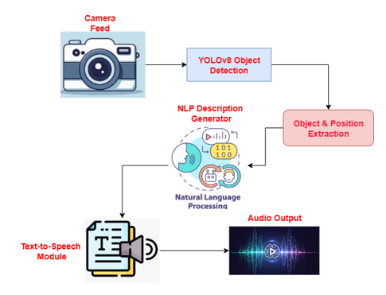
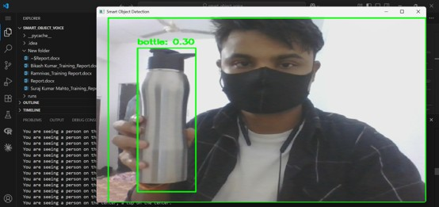
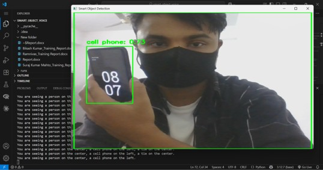
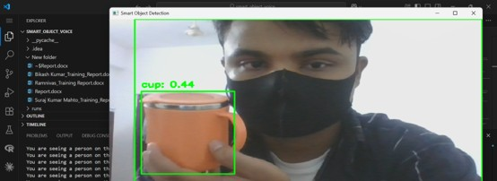
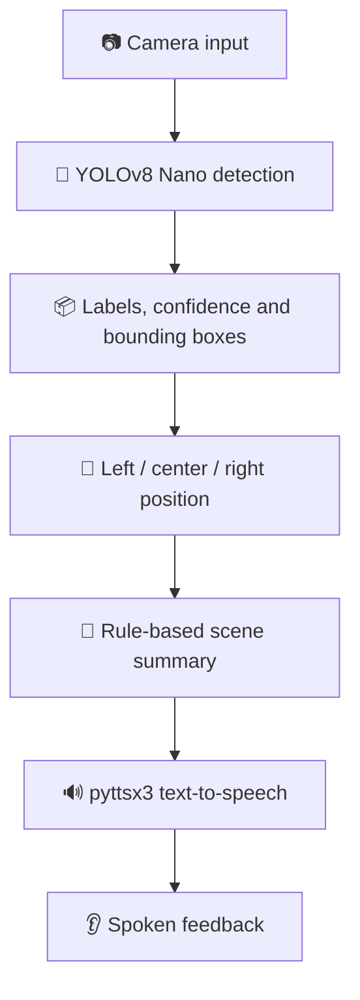

<div align="center">

# 🔎 Smart Object Detection with Voice Summary

### An AI-powered visual assistant that describes detected objects aloud

<p>
  <a href="https://github.com/Surajkhanal777/Smart-Object-Detection-Voice-Assistant"></a>
  <a href="https://github.com/Surajkhanal777/Smart-Object-Detection-Voice-Assistant/issues"></a>
  <a href="https://github.com/Surajkhanal777/Smart-Object-Detection-Voice-Assistant"></a>
  
  
  
</p>

**Project:** [Surajkhanal777/Smart-Object-Detection-Voice-Assistant](https://github.com/Surajkhanal777/Smart-Object-Detection-Voice-Assistant) · **Focus:** AI/ML · Computer Vision · Accessibility

</div>

---

## 🌟 Overview

**Smart Object Detection with Voice Summary** is a Python-based assistive prototype designed to make camera scenes easier to understand through audio. It uses a camera feed and the lightweight **YOLOv8 Nano** model to identify supported objects, estimate their horizontal position (**left, center, or right**), and turn the detections into a short text summary. A text-to-speech engine can then read the summary aloud.

The project is intended as a learning prototype and an accessibility aid. It is **not a certified mobility or obstacle-avoidance system** and should not be used as the sole source of navigation or safety information.

## ✨ Key Features

- 🎯 **Real-time object detection** with Ultralytics YOLOv8 Nano (`yolov8n.pt`).
- 📍 **Approximate position cues** — left, center, and right based on the object's bounding-box center.
- 🧠 **Readable scene summaries** that group repeated object labels and include position information.
- 🔊 **Voice feedback** using local `pyttsx3` text-to-speech.
- 🎥 **Camera options** for a laptop webcam and a configurable mobile/IP camera feed.
- 🖥️ **Flask dashboard** for starting/stopping camera processing, switching camera mode, toggling voice, and viewing detections.
- 🧩 **Modular Python code** separating detection, description, voice input/output, and web serving.

> **Implementation note:** The repository code currently uses template/rule-based descriptions in `description_nlp.py` and `pyttsx3` for speech output. Voice camera selection uses `SpeechRecognition` with Google's online recognition service, so that voice-input feature requires internet access. Hugging Face TTS / transformer-based caption generation are discussed in the training report as possible/target technologies, but are **not the current implementation in this repository**.

## 🖼️ Project Preview

### System workflow

The diagram below is taken from the project training report. The implemented code follows the same broad visual-to-audio flow, with rule-based sentence generation and `pyttsx3` speech output.

<div align="center">
  
</div>

### Detection examples

These are screenshots captured during project testing and included in the training report. They illustrate detections; results can vary with lighting, distance, camera quality, and model confidence.

<table>
  <tr>
    <td align="center" width="33%"><br><b>🧴 Bottle detection</b></td>
    <td align="center" width="33%"><br><b>📱 Mobile phone detection</b></td>
    <td align="center" width="33%"><br><b>☕ Cup detection</b></td>
  </tr>
</table>

## ⚙️ How It Works



1. **Capture:** OpenCV reads frames from the selected camera.
2. **Detect:** YOLOv8 predicts supported object classes, confidence scores, and bounding boxes.
3. **Locate:** The horizontal center of each bounding box is mapped to left, center, or right.
4. **Summarize:** Python logic counts repeated labels and builds a concise description.
5. **Speak:** `pyttsx3` speaks the description; the dashboard can also display detections and status.

## 🧰 Tech Stack

| Technology | Role in this repository |
|---|---|
| 🐍 Python | Application logic and integration |
| 🎯 Ultralytics YOLOv8 Nano | Pre-trained object detection |
| 👁️ OpenCV | Camera capture, frame processing, and drawing bounding boxes |
| 🔢 NumPy | Image byte/frame handling |
| 🗣️ `pyttsx3` | Local text-to-speech output |
| 🎙️ `SpeechRecognition` + PyAudio | Voice input for camera selection in the CLI workflow |
| 🌐 Flask + Flask-CORS | Web dashboard and JSON endpoints |

## 🚀 Getting Started

### 1. Prerequisites

- Python **3.10 or 3.11** is recommended for the pinned dependency versions.
- Git and `pip`.
- A webcam, or a reachable mobile/IP-camera image endpoint.
- Speakers/headphones for voice output; a microphone for voice-based camera selection.

> **Windows audio note:** PyAudio installation can depend on your Python version and system setup. If `pip install -r requirements.txt` fails at PyAudio, install a compatible PyAudio wheel/package for your Python version and retry.

### 2. Clone the repository

```bash
git clone https://github.com/Surajkhanal777/Smart-Object-Detection-Voice-Assistant.git
cd Smart-Object-Detection-Voice-Assistant/smart-object-detection-voice-assistant
```

### 3. Create a virtual environment

**Windows PowerShell**

```powershell
py -3.11 -m venv .venv
.\.venv\Scripts\Activate.ps1
python -m pip install --upgrade pip
pip install -r requirements.txt
```

**macOS / Linux**

```bash
python3.11 -m venv .venv
source .venv/bin/activate
python -m pip install --upgrade pip
pip install -r requirements.txt
```

### 4. Run the command-line application

```bash
python main.py
```

The CLI workflow asks for camera selection by voice. Press **`q`** in the OpenCV window to exit the camera loop.

### 5. Run the Flask dashboard

```bash
python web_server.py
```

Then open [http://127.0.0.1:5000](http://127.0.0.1:5000) on the same computer. Use the dashboard controls to start/stop the camera and toggle voice output.

## 📱 Configure a Mobile / IP Camera

The current source contains a local camera endpoint in `main.py` and `web_server.py`. Before using mobile-camera mode:

1. Find the image/stream URL provided by your IP-camera app.
2. Update the configured URL in the relevant source file(s).
3. Ensure the phone and computer are on the same network and the endpoint is reachable.
4. Keep private camera URLs, tokens, and credentials out of commits and screenshots.

The mobile camera URL is currently hard-coded in source; making it an environment variable is a useful next improvement.

## 📊 Reported Performance

The short-term training report records the following figures from project testing:

| Metric | Figure reported in the report |
|---|---:|
| Object detection accuracy | ~85% |
| Processing latency | ~0.12 seconds per frame |
| Additional audio delay | ~0.1 seconds |
| CPU processing speed | ~12–15 FPS |
| Speech clarity / understandability | ~92% |

**Please interpret these as report-reported results, not independently reproduced benchmark results.** The report does not provide enough detail about the test-set size, ground-truth labeling, hardware specification, repeated runs, or the calculation method to independently verify the metrics. Performance will vary by hardware, scene, lighting, camera resolution, and model configuration. A stronger benchmark should record precision, recall, mAP, per-stage latency, hardware details, and the evaluation dataset.

## 🗂️ Project Structure

```text
smart-object-detection-voice-assistant/
├── main.py                  # Command-line camera workflow
├── object_detector.py       # YOLOv8 inference and position extraction
├── description_nlp.py       # Rule-based scene summary generation
├── voice_input.py           # Microphone input / speech recognition
├── tts_speaker.py           # pyttsx3 speech output
├── web_server.py            # Flask dashboard and API endpoints
├── templates/
│   └── index.html           # Dashboard page
├── yolov8n.pt               # YOLOv8 Nano model weights
├── requirements.txt
├── .gitignore
└── README.md
├── screenshots/
│   └── bottle-detection.jpg
│   └── cup-detection.jpg
│   └── mobile-phone-detection.jpg
│   └── system-architecture.jpg
│   └── Testing with an Elephant photo to recognize.jpg
│   └── Testing for car recognition.jpg
```

## ⚠️ Limitations & Responsible Use

- The model is pre-trained on common object categories; it may not recognize unfamiliar or specialized objects.
- The position cue describes **horizontal image location only**. It does not estimate distance, detect drop-offs, or calculate a safe route.
- Objects can be missed or mislabeled, especially in poor lighting, clutter, occlusion, or motion.
- The CLI voice-recognition path uses an online Google service and may fail without internet access.
- Speech synthesis depends on the local operating system's available voices and audio setup.
- The Flask development server and current permissive CORS configuration are not hardened for public deployment. Run locally on a trusted network; do not expose it directly to the internet without adding authentication, restricting CORS, and reviewing network binding and camera access.
- This is a prototype, not a replacement for a cane, guide dog, orientation-and-mobility training, or other established accessibility support.

## 🛣️ Roadmap

- [ ] Move camera URLs and runtime settings into environment/configuration variables.
- [ ] Add unit tests for position extraction and description generation.
- [ ] Restrict CORS and add authentication before any network-facing deployment.
- [ ] Add repeatable evaluation scripts and document the test dataset/hardware.
- [ ] Improve description grammar and reduce repeated spoken announcements.
- [ ] Explore multilingual/offline speech options and optimized edge-device deployment.
- [ ] Add depth estimation only after a suitable sensor/model and evaluation plan are selected.

## 🤝 Contributing

Suggestions and bug reports are welcome. Please open an [issue](https://github.com/Surajkhanal777/Smart-Object-Detection-Voice-Assistant/issues) with steps to reproduce a problem, your operating system, Python version, and relevant error logs. Remove private camera URLs and personal information before sharing logs.

## 📜 License

This project is licensed under the MIT License. You are free to use, copy, modify, and distribute this software, subject to the terms and conditions of the license.

See the LICENSE file for the full license text.

---

<div align="center">

### 💙 Built to explore how computer vision can make technology more accessible

If this project helps your learning, consider ⭐ starring the repository and sharing constructive feedback.

</div>
